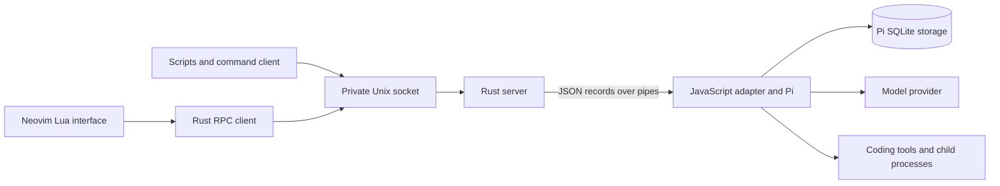

# Architecture

Read this document when you change process ownership, saved state, protocol
delivery, or the editor lifecycle. Use [SPEC.md](SPEC.md) for the affected
application requirements and [README.md](README.md) for installation and use.
Use [PERFORMANCE.md](PERFORMANCE.md) for resource limits and measurement.

## Process and state ownership

One Rust server and one Pi worker serve all sessions in a state directory.
A new chat creates a stored conversation, not another Node process. This shares
the provider code, database connection, and execution runtime across clients.

| Component | Responsibility and reason |
| --- | --- |
| Rust server | Own the private socket, client limits, worker lifecycle, and output queues. Keep these controls independent of editor and provider failures. |
| Rust client | Use the same protocol for scripts and Neovim. Preserve request identifiers so callers can resolve uncertain submissions. |
| JavaScript adapter | Translate public requests to Pi operations and limit public previews. Reuse Pi storage, scheduling, tools, and provider integration. |
| Pi Durable | Own conversation entries, submission outcomes, recovery, and cancellation. Keep one authority for saved execution state. |
| Lua interface | Manage native windows, drafts, explicit file attachments, and bounded display data. Let normal Neovim file and write checks remain effective. |

The server passes its storage lock to the worker. If a server fails while its
worker is alive, another server cannot open the same storage. Startup restores
session metadata and conversation handles. It does not load every transcript.

## Requests and progress

A submission has a caller-supplied request identifier. A retry uses that same
identifier and original input. Pi stores the accepted submission and its result;
the adapter does not create a second execution log or recovery state machine.

A watch gives an initial snapshot and later replacement snapshots. Ordinary
progress is published at most ten times per second. A terminal state is published
promptly. Each output queue keeps only the newest pending snapshot for a watch.
This prevents a slow client from retaining every progress update.

Snapshots describe current state. They are not an event history and do not prove
the outcome of a particular submission. Scripts use `submission.get` or
`submission.wait` for that outcome. A stop request names its target submission;
it must not cancel a later run by mistake.

## Memory and editor lifetime

Saved transcript entries remain in SQLite. Public snapshots contain up to 50
entry previews and fit within 512 KiB. Individual text previews have an 8 KiB
limit. Older pages and complete text are available through separate requests.
The adapter keeps Pi's ten-minute idle context cache and sets unused document
retention to 30 seconds. Pi reloads expired documents from its storage when
needed. Active contexts and observed documents remain available. The adapter
adds no context cache or expiry timer.

The editor treats transcript text as generated data. It disables undo storage
for transcripts and the sidebar, while editable prompts keep normal undo.
An unchanged render does not write buffer text. A changed render replaces only
the differing line range and restores the required highlights and scroll state.

Loaded history has a separate limit of 200 entries and 1 MiB of entry text,
identifiers, and kinds. The current snapshot remains visible beside that history.
Loading older pages can discard newer cached pages. A notice explains the limit.
Hide and reopen the chat to return to recent pages and reload discarded pages.

When no window displays a chat buffer, the interface releases its generated
text, highlights, and loaded history. Its native buffer identity remains, so
normal buffer navigation can reopen it. Hidden progress does not format text.
The editor preserves drafts, attachments, uncertain submission identifiers, and
the set of sessions used by the exit check. The sidebar retains execution state
and the active submission identifier, not complete snapshots.

## Deliberate limits

The selected session can keep its watch while its chat is hidden. This preserves
live sidebar state and the displayed stop target. Switching sessions releases
the previous watch; normal editor exit still checks all sessions attached during
that editor's lifetime. Hiding a chat never stops its work.

Pi's watched view can contain the full active model context before the adapter
constructs a small public preview. The public snapshot limit therefore does not
limit the worker's view memory. Releasing the selected hidden watch safely needs
a smaller status interface or an equivalent Pi observation facility.

The worker remains alive when sessions are idle and imports the provider catalog
at startup. Provider SDKs and login implementations already load when required.
Automatic worker suspension is not implemented. It needs evidence that its memory
saving justifies restart cost and preserves admission, recovery, authentication,
and active tools.

The Rust server waits for socket or pipe readiness and actual deadlines. It does
not wake every five milliseconds to check idle connections. Resource measurements
must include the worker, client processes, editor, and tools, not only the server.
