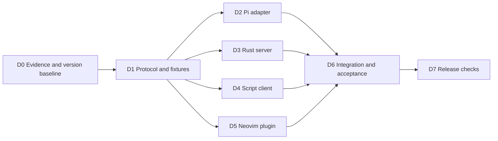
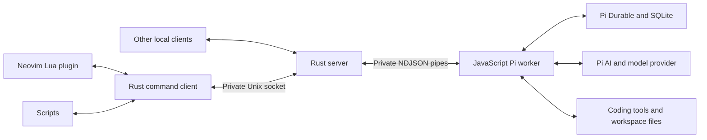

# Personal agent first version specification

This specification defines a small personal coding agent with a Neovim interface.
It also defines a command client and a public interface for scripts.
The first version runs on one Linux machine.
Its interfaces permit later remote access without moving agent logic into clients.

The application uses Pi Durable for agent execution and persistent state.
It uses Pi AI for model access.
The server and command client use Rust.
A small JavaScript adapter runs Pi. A small Lua plugin connects Neovim.
The user accepted these two language exceptions.

This is the implementation specification for version one.
The words **must**, **should**, and **may** mean required, preferred, and optional.
Design limits below are requirements, not measured results.

## Terms

| Term | Meaning |
| --- | --- |
| Server | The independent Rust process that accepts client connections and owns the Pi worker. |
| Worker | The JavaScript process that runs Pi and owns its storage. |
| Session | One application conversation with a fixed workspace and agent configuration. |
| Submission | One input accepted by Pi. Its identifier remains valid after a restart. |
| Run | The work for one accepted input. Version one permits one active run per session. |
| Workspace | The directory in which a session reads files and executes tools. |
| Snapshot | A complete replacement for the public session view. It is not a database backup. |
| Request identifier | A client value that prevents repeated input delivery from creating more work. |
| Adapter | A small module that translates one interface into another. |
| NDJSON | Newline delimited JSON. Each line contains one complete JSON value. |
| RPC | Remote procedure call. A client requests an operation and receives its result. |
| DSL | Domain specific language. A language for a restricted application purpose. |

`harness` is the command name used by this specification.
`Harness` is the Neovim command name. These names do not select a distribution name.

## Scope

The first version must provide:

1. A custom server that Neovim can start when no compatible local server is available.
2. Persistent sessions with text input, streamed state, coding tools, and stored results.
3. A plain Neovim transcript and prompt, with explicit editor context attachments.
4. A command client that works without Neovim, prompts, or a terminal interface.
5. Reconnection through a current snapshot followed by later state updates.
6. Duplicate protection for accepted inputs, including retries after a process restart.
7. Explicit stop commands and a normal editor exit confirmation.
8. Recovery of pending work after a process failure, according to Pi tool replay rules.
9. A measured dependency inventory and passing format, lint, and test checks.

The following work is outside version one:

- A DSL, workflow language, or dynamic extension loader.
- Subagents, conversation forks, steering, and queued follow-up inputs.
- A web interface, HTTP service, TCP listener, TLS, or remote deployment automation.
- Remote file synchronization and continuous synchronization of unsaved editor buffers.
- OAuth login screens, subscription login, image input, image generation, and code mode.
- A permission dialog system, sandbox, multi-user service, and scheduled task engine.
- A second storage system, custom model loop, custom tool framework, or event replay journal.

Scripts may invoke the client from an existing scheduler.
Scheduling is not a responsibility of the server.
Tools run with the operating system permissions of the server user.
Version one is for that user's trusted workspaces.

## Deliverables and parallel work

Deliverables must produce reviewable code, contract fixtures, and their relevant tests.
The application requirements remain in `SPEC.md`.
Operational instructions, measured dependency results, and release evidence belong in `README.md`.
Fixture JSON, source code, lockfiles, and test reports are not additional prose specifications.
Do not modify the saved source documents in `dev-docs/`.

| Deliverable | Required output | Completion condition | Dependencies |
| --- | --- | --- | --- |
| D0 Integration and dependency baseline | Exact runtime versions, Pi artifact mapping, dependency audit, minimal Pi API probes, ownership proof, and Neovim exit proof. Record the baseline in README.md. | Prove install, reopen, duplicate lookup, atomic watch, targeted stop, replay policy, and safe normal exit. Resolve reference/API differences. | None. |
| D1 Protocol and fixtures | Rust protocol types, error mapping, snapshot shape, sample RPC records, limits, and shared fixtures. | Rust, Node, and Lua can consume the same fixtures. Freeze application contracts before parallel feature work. | D0. |
| D2 Pi adapter | Persistent sessions, selected provider, built-in tools, snapshots, submissions, and stop. | Adapter tests satisfy storage and execution requirements with the faux provider. | D1. |
| D3 Rust server | Private socket, instance ownership, worker control, bounded routing, and readiness. | Startup, failure, ownership, and slow-client tests pass with a fake worker. | D1. |
| D4 Script client | Shared client library, commands, RPC proxy, and exit statuses. | Script tests pass against a protocol fixture server. | D1. |
| D5 Neovim plugin | Native panels, commands, explicit context, reconnect, and confirmed normal exit. | Editor tests pass against a fake client process. The proven exit mechanism preserves write checks. | D1 and D0 exit proof. |
| D6 Integration | Real Rust-to-Pi path and complete acceptance tests. | A01 through A27 pass, with recorded interactive evidence where necessary. | D2, D3, D4, D5. |
| D7 Release checks | Locked build, dependency check, installation steps, configuration example, and operational README. | Format, Clippy, tests, release build, and clean installation pass. | D6. |

D0 investigations may run in parallel: Pi APIs, dependency audit, process ownership,
and editor exit behaviour have separate owners.
Their results must agree before D1 freezes the contracts.

D2, D3, D4, and D5 may run in parallel after D1.
Use fake implementations at their shared boundaries.
The protocol owner must approve contract changes and update all shared fixtures.
Assign one owner to each source area. Do not edit shared protocol files concurrently.

Within D6, run protocol, recovery, script, and editor test groups in parallel.
They must use separate temporary state directories and sockets.
Within D7, documentation, dependency review, and clean-install checks may run in parallel.
The release gate remains joint: no deliverable is complete with a failed required check.



## Architecture and language boundaries



The server and command client must use one Rust package and shared protocol types.
The package must expose a library for its reusable modules and one executable.
Add more workspace packages only when a demonstrated boundary requires them.

| Module | Responsibility |
| --- | --- |
| `protocol` | Request, response, snapshot, error, and size-limit types. |
| `application` | Transport independent operations and session access. |
| `server` | Socket acceptance, connection limits, and request routing. |
| `worker` | Child process control, private protocol, readiness, and failure reporting. |
| `client` | Connections, correlation, snapshots, and explicit retry handling. |
| `process` | Linux process ownership, instance locking, and process cleanup. |
| `config` | Configuration loading, paths, and validation. |
| `cli` | Argument handling, standard input/output, and exit status. |

Keep interfaces small. Use concrete types until more than one implementation needs an abstraction.
Keep operating system calls and any necessary unsafe Rust inside `process`.
Document the safety condition beside each unsafe block.

The JavaScript adapter must only configure Pi, execute application operations,
translate Pi state, and manage Pi resources.
Reuse Pi's model loop, storage, retry handling, compaction, and coding tools.
Do not implement these functions again in Rust.
Use plain `.mjs` files and Node built-ins. Do not add a compilation or bundling step.

The Lua plugin must only manage editor commands, buffers, context, and exit interaction.
It must use the Rust client's standard-input/output connection mode.
It must not contain provider code, credentials, agent policy, or a separate network client.

A future remote client can use the same operations through an SSH or HTTP adapter.
The initial protocol must not assume that a client can read the server filesystem.
The workspace belongs to the server. Context attachments contain text explicitly.
Remote transport, authentication, and deployment remain separate future work.

The private server-to-worker protocol must use the same framing and public data types.
Its version handshake must identify the Node release and pinned Pi artifacts.
Only the server may send worker lifecycle operations.
The server must translate connection request identifiers into unique worker identifiers.
It must route each result and watch update back to the correct client.
Use standard output only for protocol records and standard error for diagnostics.
One waiting request must not block the worker from reading another command.

## Initial platform and version policy

The initial supported platform is Linux with a local filesystem and Unix sockets.
The initial Neovim test target is version `0.12.6`, matching the saved reference.
Do not claim support for older editors until their tests pass.

Use Rust edition 2024. Pin an exact stable Rust toolchain in `rust-toolchain.toml`.
Include the `rustfmt` and `clippy` components.
Select and record the toolchain during deliverable D0.

Use an exact compatible Node release. The indexed Pi manifests require Node `>=22.19.0`.
D0 must verify the selected Node release with Pi's built-in SQLite adapter.
Record the supported Node and npm versions in `README.md`.

The saved Pi source revision is `4dd2b149d155d7369de16ea4dc77c84e9f5ffb24`.
Its manifests report `1.3.0`. This is a source snapshot, not proof of a matching published package.
D0 must identify the installable artifacts, source relationship, and integrity values.
Use exact package versions and commit lockfiles. Do not use floating Git references.
If published artifacts differ, review that difference before freezing the implementation baseline.

## Process ownership and startup

There must be one server and one Pi worker for each configured state directory.
The worker must own one SQLite database containing all application sessions.
Only the worker may open Pi storage. Rust must not query Pi tables directly.

Use these default paths:

| Item | Location |
| --- | --- |
| Configuration | `$XDG_CONFIG_HOME/harness/config.json`, or `$HOME/.config/harness/config.json`. |
| State | `$XDG_STATE_HOME/harness`, or `$HOME/.local/state/harness`. |
| Socket | `$XDG_RUNTIME_DIR/harness/control.sock`, or `run/control.sock` below the state directory. |
| Database | `agent.sqlite` below the state directory. |
| Logs | `logs/` below the state directory. |

The default runtime socket applies only to the default state directory.
A custom state directory must specify a distinct socket path.
The version handshake must report the canonical state directory.
Before reusing a server, startup must verify both protocol and state-directory identity.
An endpoint for another state directory is a conflict, not a reusable instance.

Create private directories with mode `0700` and private files and sockets with mode `0600`.
Reject paths owned by another user and unsafe symbolic links at managed endpoints.
Report an overlong Unix socket path with a configuration remedy.
Do not use a world-writable temporary directory as the fallback.

`harness start` must be idempotent. It must:

1. Connect and check protocol compatibility when a server is already available.
2. Acquire exclusive instance ownership before removing any stale endpoint.
3. Start an independent server with standard input closed and logs redirected.
4. Start the worker, validate its version, and wait for storage readiness.
5. Return success only after a compatible server answers `system.hello`.

Use a ten-second startup deadline. A timeout must leave a clear diagnostic.
Two simultaneous starters must converge on one server.
A PID file or socket file alone is insufficient evidence of a live compatible server.
Never replace or terminate an incompatible live server automatically.

The storage lock must remain effective while either the server or worker can own storage.
An orphan worker must prevent a second worker from opening the database.
Use an operating system lock with a proven descriptor lifetime, including across child creation.
D0 must prove this behaviour before the process design is accepted.

Neovim may start the server only when the user first invokes a plugin command.
Loading the plugin must not start processes or make provider requests.
The client proxy must not own the server lifetime.
Closing a pipe, terminal, or client connection must not imply a run stop.

When its parent pipe closes, the worker must close Pi and its execution environment, then exit.
Pending work remains available for recovery. This is not a successful explicit stop.
After a worker crash, the server must report unavailability.
Close client connections with affected watches so clients cannot retain a silently dead subscription.
It must clean up ordinary owned tool processes before replacing the worker.
Permit at most three worker restarts within sixty seconds. Then stop automatic recovery.
Never run two workers against the same database during recovery.

Provide `harness restart-worker` as an explicit recovery operation after that limit.
Permit it when no worker remains, or when preflight keeps the current worker fully paused.
For a paused worker, close it without enabling scheduling and wait for it to exit.
Recheck ownership before opening a replacement. Reload configuration before its preflight.
It preserves pending work and makes one new recovery attempt.
It must not report pending work as cancelled.

`server.shutdown` must block new mutations before checking for active work.
Wait for mutations already in admission to finish before making that check.
It must reject shutdown while any session has active work, then restore normal admission.
It must not stop runs implicitly. The caller must stop them first.
For an idle server, close the worker and storage while admission remains blocked.
Send the shutdown result, close connections, remove the owned socket, and release ownership.
Keep process shutdown separate from run cancellation.

SIGTERM is an administrative process exit, which preserves unfinished work for later recovery.
Stop admission, close Pi without marking runs cancelled, and wait for worker cleanup before exiting.
This permits a server restart with a corrected environment when provider credentials change.
Clients must observe disconnection, not a successful run-stop result.
Use `harness start` afterward to restore the service and recover pending work.

## Agent configuration and persistent state

The configuration file must use JSON, so no additional configuration parser is required.
Command arguments may override configuration and state paths.
Resolve relative configuration paths against the configuration directory.
Reject unknown configuration keys with a useful error.

The initial configuration must contain:

- A default provider identifier and model identifier.
- A fixed agent instruction string, which may be empty.
- The installed Node executable and worker entry path, when defaults are insufficient.
- Optional state and socket path overrides.

Use the keys `provider`, `model`, `instructions`, `node_path`, `worker_path`,
`state_dir`, and `socket_path` for these values.
`provider` and `model` are required for creating a new session.
`instructions` defaults to an empty string. Path keys use the defaults defined above.
The installed worker path defaults to the adapter supplied with the executable.
Configuration may not point to an automatically downloaded worker.

Use API keys through the provider's documented environment variables.
Do not copy provider credential values into session metadata, client messages, command arguments, or diagnostics.
Provider credentials belong to the server environment.
User text and tool output may contain sensitive values supplied by the user or workspace.
Version one does not promise automatic redaction of arbitrary transcript content.
Diagnostic logs must omit prompt bodies, tool output, and environment dumps.
Bound logs to two files of at most 10 MiB each.
There must be no default model that causes an unexpected paid request.
An absent or invalid model configuration must produce a clear error before input admission.

D0 must select one hosted provider adapter for the initial release.
Use the smallest necessary Pi provider import for that adapter.
The choice must be recorded here with its credential variable and model configuration example.
Use Pi's faux provider for deterministic tests. Real provider credentials must not be required for CI.
Additional provider factories can be added later without changing the public API.

Each session maps to one ownerless Pi conversation.
Persist application metadata through a small `app.session` Pi document.
Store the public session identifier, workspace, fixed agent configuration, and schema version.
Create that metadata in the same Pi transaction as the conversation.
Rebuild the session lookup from stored metadata before accepting requests after a restart.
Do not create a second Rust session database.

The workspace must be an existing absolute canonical directory.
Freeze the workspace, model, instructions, and offered tools for the session.
Changing these settings requires a new session in version one.
Do not silently select the server's current directory.

Register Pi's existing `read`, `write`, `edit`, and `bash` tools and its Node execution environment.
Do not add agent-accessible tools for session creation, subagents, background work, or configuration.
Use Pi's existing context compaction. Expose its activity as session state.
Disable background compaction with `compaction.backgroundTokens: 0`.
Keep ordinary threshold and overflow compaction within the active run.
This prevents model work from surviving a confirmed stop as a background compaction task.
Do not introduce a custom memory system.

Only one input may be active in a session.
Use Pi's reject-when-busy behaviour. Do not queue a new input in version one.
Different sessions may run concurrently within the worker's configured limit.

## Public protocol

### Transport and framing

Use a documented JSON-RPC 2.0 subset over the private Unix stream socket.
Each request, response, or notification must be one compact UTF-8 JSON object plus `LF`.
JSON strings must escape embedded newlines. Read code must handle partial and combined records.
Reject batches in version one. Do not execute client notifications.
Close the connection for an unsupported notification without sending a response to that notification.
Clients must give requests a nonempty string `id` of at most 128 bytes.
An identifier must be unique among that connection's unfinished requests.
Responses may arrive out of order. A waiting request must not block later stop requests.
The server uses notifications only for session watches.

The connection `id` correlates a response. It is not a durable request identifier.
`request_id` identifies an input within one session and survives connection loss.
Session identifiers and request identifiers must use `[A-Za-z0-9_-]`, with length 1 through 128.
Pi submission and entry identifiers are opaque strings. Clients must not parse their structure.

Every connection must call `system.hello` before other operations.
The request gives `api_version: 1`.
The response gives the agreed version, instance identifier, canonical state directory, readiness, and limits.
An incompatible version must fail before a mutation.
The instance identifier changes after a server restart and must not identify a stored session.

Example input request:

```json
{"jsonrpc":"2.0","id":"c7","method":"input.submit","params":{"session_id":"work","request_id":"task_001","text":"Run the tests and explain failures.","context":[]}}
```

Example acceptance response:

```json
{"jsonrpc":"2.0","id":"c7","result":{"session_id":"work","request_id":"task_001","submission_id":"opaque-id","status":"accepted"}}
```

### Operations

| Operation | Required input | Result and rule |
| --- | --- | --- |
| `system.hello` | `api_version` | Version, instance, readiness, limits. |
| `session.create` | `session_id`, `workspace` | Stored metadata. The same identifier and workspace return the existing session. A different workspace returns a conflict. |
| `session.list` | Optional `cursor`, `limit` | Metadata page and next cursor. Default limit 50, maximum 100. |
| `session.get` | `session_id` | Metadata and current public snapshot. |
| `session.watch` | `session_id` | Watch identifier and initial snapshot. Later notifications replace that view. |
| `session.unwatch` | `watch_id` | Release that watch. Repeat calls are harmless. |
| `input.submit` | `session_id`, `request_id`, `text`, `context` | Stored submission identifier. New input fails when busy. |
| `submission.get` | `session_id`, `request_id` | Stored admission state or final outcome. Unknown input is an error. |
| `submission.wait` | `session_id`, `request_id`, optional `timeout_ms` | Exact final outcome, or a timeout error that leaves work active. |
| `run.stop` | `session_id`, `submission_id` | Stored target outcome after stopping, or its existing terminal outcome. |
| `transcript.list` | `session_id`, optional `cursor`, `limit` | Ordered entry previews. Default limit 50, maximum 100. |
| `entry.read` | `session_id`, `entry_id`, optional `offset`, `limit` | A chunk of the entry's public text, the next offset, and an end flag. |
| `server.shutdown` | None | Success only after an idle server completes controlled shutdown. |
| `server.restart_worker` | None | One explicit recovery attempt with no worker, or after closing a worker fully paused by preflight. Reject a worker with enabled scheduling. |

Validate object types, required fields, lengths, and unknown fields before dispatch.
Opaque cursors must be restricted to the session and query that created them.
Version one has no delete operation or automatic history removal.
Use structured errors for unknown sessions, submissions, and entries.
Watch identifiers are scoped to their connection. Removing an absent watch succeeds without effect.

Session creation must be serialized across concurrent clients.
Its lookup and atomic metadata creation must prevent duplicate conversations after a lost response.
Compare an existing session against the supplied workspace before applying current defaults.
Changed default model or instructions must not alter an existing session or invalidate its retry.
D0 must verify this with the pinned Pi APIs.

### Duplicate inputs and outcomes

Pass `request_id` unchanged to Pi as the input's `requestId`.
The first admitted input owns that identifier within the session.
A retry must return the same submission, even after a restart or while another input is active.
Duplicate lookup must precede busy, capacity, and current provider-readiness checks for a new input.
Known receipts remain readable while the worker can read storage but cannot execute new work.

If a caller reuses an admitted identifier with different text, the original input still wins.
The replacement text must not execute. Version one does not promise a changed-body conflict error.
Clients must retain the original request envelope until admission is known.
An input rejected before admission does not reserve its request identifier.
Generate a new identifier for each distinct task.

An accepted response means that Pi stored the input. It does not mean that the run succeeded.
Stored admission status is `accepted` until the submission becomes terminal.
Terminal outcomes are `done` or `unanswered`.
`done` includes the final answer entry identifier.
`unanswered` includes a stable application reason and a readable message.
Preserve the distinction between cancellation, provider failure, storage failure, and blocked recovery.
Blocked recovery is a current state, not a successful or terminal answer.

A lost response means that the outcome is unknown to that client.
The caller must query or retry the same request identifier.
The server must never infer a new task from a transport retry.
This guarantee covers input admission. It does not make external tool actions execute exactly once.

### Snapshots and observation

Acquire the initial view and its subscription atomically through Pi's watch interface.
Do not read a snapshot and then create a separate subscription.
Queue the `session.watch` response before notifications for that watch.

For version one, every `session.state` notification contains a complete public snapshot.
Avoid exposing Pi document operations or requiring a second state reducer in each client.
The notification contains `watch_id`, a connection-local sequence number, and `snapshot`.
Each snapshot replaces the previous view. Its sequence number is not a durable replay cursor.

The snapshot must contain:

- Session metadata, connection-independent execution state, and a readable error if present.
- The active submission identifier, or `null` when no input is active.
- The current assistant text preview and active tool summaries.
- Recent transcript entry previews with stable entry identifiers.
- Compaction or retry activity when present, and usage totals when Pi supplies them.
- Explicit truncation flags and a history cursor for content outside the preview.

Normalize session states to `idle`, `running`, `stopping`, `recovering`, `blocked`, or `unavailable`.
A client must show connection state separately from execution state.
Treat stale cached state as unknown after a connection failure.

Publish ordinary progress at most ten times per second.
Publish a terminal state promptly, without waiting for the next progress interval.
Keep only the newest pending snapshot for a slow watch.
Pi may also replace accumulated updates with a new snapshot.
The stream promises current state convergence, not delivery of every intermediate transition.

Reconnect by calling `session.watch` again and discarding the old watch state.
Do not request event replay or interpret a stream ending as successful completion.
Scripts must use `submission.get` or `submission.wait` for exact outcomes.

### Text and resource limits

Enforce these initial limits in the client, server, and worker where applicable:

| Resource | Limit |
| --- | ---: |
| Encoded protocol record | 4 MiB, including the final newline. |
| Input text and all attached text combined | 1 MiB in UTF-8. |
| Context attachments per input | 16. |
| Public snapshot | 512 KiB encoded. |
| Recent transcript items per snapshot | 50, further reduced to fit the snapshot limit. |
| Text preview per item or live tool | 8 KiB, with a truncation flag. |
| `entry.read` text chunk | 64 KiB maximum. |
| Connected clients | 32. |
| Pending RPC requests per client | 32, including waits. |
| Watches per client | 8. |
| Concurrent active sessions | 4. |
| Unsent non-watch output per client | 4 MiB. |

These are initial design bounds. Change them through a reviewed specification change.
UTF-8 text chunks must end on character boundaries.
Offsets are byte offsets into a stable public text representation of a stored entry.
The response gives the next valid offset. Reject an invalid offset.
Never truncate the stored final answer to satisfy a transport limit.
Use `entry.read` to obtain its complete public text.

Admission and stop requests must remain responsive during a slow client or long model call.
Use bounded threads, queues, and channels. Do not spawn an unbounded thread per request.
A full queue must return a resource error or close only the affected client.
Client output must never block the Pi execution loop.
Malformed or oversized records must not reach Pi.

### Error contract

Use the standard JSON-RPC parse, invalid-request, unknown-method, and invalid-parameter codes.
Application errors use code `-32000` with a stable `data.kind` value.
Required kinds are `incompatible_version`, `not_found`, `conflict`, `busy`,
`not_ready`, `resource_limit`, `timeout`, `provider_error`, `storage_error`, and `internal_error`.
Include a short readable message. Do not include secrets or internal stack traces.
Validation errors may include the invalid field name.

Use `busy` for a new input in an active or stopping session.
Use `resource_limit` when the global active-session limit is reached.
An internal error must be logged with a correlation identifier.
Diagnostic logging must not alter protocol output.

## Stop and recovery rules

`run.stop` targets a stored submission, not whichever run happens to be current later.
Serialize mutations for that session while the stop operation is in progress.
Do not block read operations, watches, or other sessions.

If the target is terminal, return its stored outcome without affecting later work.
If the target is the active submission, call Pi's conversation abort operation.
Wait until its foreground work is idle and its terminal outcome is stored.
Only then send a successful response.
If the run finishes naturally during the race, return its actual stored outcome.
Do not rewrite a completed answer as a cancellation.

Use a worker-owned operation context for stopping.
A client timeout or disconnection may abandon its wait, but must not reverse the stop operation.
There is no early stop-accepted response and no separate application stop ledger.
Before a success response, a failure leaves the outcome unknown to the caller.
Query or retry the same target. Never substitute a later active submission.

On restart, restore provider configuration and tool definitions before enabling Pi scheduling.
Rebuild public session metadata and expose recovery state.
Use one preflight check for all unfinished work because the Pi scheduler is shared.
If any unfinished work cannot restore its required configuration, keep the complete harness paused.
Expose the affected sessions as blocked and execution readiness as false.
Historical sessions with no unfinished work must not block other sessions.
Validate their fixed configuration when they next receive a new input.
Read stored status and watches without enabling scheduling.
Reject new inputs and waits or stops for active targets with `not_ready`.
Terminal waits and stops may return stored outcomes through read operations only.
Pi's submit, wait, and abort methods can enable scheduling; do not call them in this paused state.

After the complete preflight passes, resume pending work through Pi.
Honour its persisted abort state.
An acknowledged stopped submission must never resume after a restart.
Do not silently use a replacement model or new tool definition.
Startup with no pending work must not make a generation request.
Recovery of previously accepted work may contact the configured provider.

Use Pi's existing tool replay policies.
Do not mark a tool safe to replay merely to make a test continue after a crash.
An interrupted unsafe tool must produce an interrupted result according to Pi's contract.
The model may then decide what to do next.
Stopping does not undo file changes or external actions that already completed.
Cancellation tests must include normal shell descendants.
Version one does not promise control over deliberately detached processes or external services.

Use Pi's built-in Node SQLite storage.
Its documented WAL `NORMAL` setting protects committed state against process failure.
It does not guarantee that the newest commits survive a machine power failure.
Version one promises process-failure recovery within that storage contract.
It must not claim stronger durability without a separate storage decision and tests.

## Standalone command client

The client must work in a shell, a pipeline, and a scheduled script without Neovim.
Standard output is reserved for machine results or explicitly requested answer text.
Diagnostics go to standard error. Never require a terminal for these commands.

| Command | Behaviour |
| --- | --- |
| `harness serve` | Run the server in the foreground for supervision and debugging. |
| `harness start` | Start a detached local server if necessary, then report readiness. |
| `harness status` | Report readiness, versions, and paths without starting a server. |
| `harness session create --id ID --workspace PATH` | Create or retrieve an identical session. |
| `harness session list` | List session metadata. |
| `harness send --session ID --request-id ID --stdin` | Read text from standard input and return its stored receipt. |
| `harness wait --session ID --request-id ID` | Return the exact stored terminal outcome. |
| `harness watch --session ID` | Emit the initial snapshot and later snapshots as NDJSON. |
| `harness stop --session ID --submission-id ID` | Stop the specified submission and await its stored outcome. |
| `harness shutdown` | Shut down an idle server. |
| `harness restart-worker` | Make one explicit worker recovery attempt after automatic recovery has stopped. |
| `harness rpc` | Proxy the public protocol through standard input and output. |

Support `--socket PATH` on client commands and `--config PATH` on startup commands.
Support `--timeout-ms N` on waits. Omitting it permits an indefinite wait.
Add `--text` to `wait` to print the complete final assistant answer through `entry.read`.
The default result format is one JSON object per result.
`watch` and `rpc` are streams and may return many records.

Require a caller-supplied request identifier for `send`.
This makes retries after a lost response explicit and reproducible.
The Neovim client must create and retain an identifier before it sends each draft.
Use operating system randomness through an existing standard facility.
Do not add an identifier package solely to format random bytes.

The `rpc` proxy must preserve request identifiers and JSON values.
It must not resend mutations silently or treat standard-input EOF as a stop.
After input EOF, stop accepting requests and drain outstanding responses.
Then release watches and exit. Long-running watches require standard input to remain open.
An outstanding wait remains subject to its specified timeout.
After a socket failure, it must report failure and exit.
The plugin can reconnect and retry its retained request explicitly.
Only `start` and the plugin's startup path start a missing server automatically.

Required exit statuses are:

| Status | Meaning |
| --- | --- |
| `0` | The requested operation succeeded; `wait` observed `done`. |
| `1` | The run ended unanswered for a reason other than explicit cancellation. |
| `2` | Invalid command arguments or configuration. |
| `3` | Connection, compatibility, or server availability failure. |
| `4` | A wait timed out. The run may still be active. |
| `5` | The target run was explicitly cancelled. |
| `6` | Busy, conflict, or resource-limit rejection. |
| `130` | The user interrupted the client with SIGINT. The run continues. |

`stop` returns `0` when it successfully establishes or observes the target's terminal state.
Its JSON result must still identify whether the target completed or was cancelled.

Example script, after provider configuration:

```sh
harness start
harness session create --id work --workspace "$PWD"
printf '%s\n' 'Run the tests and explain failures.' |
  harness send --session work --request-id tests_001 --stdin
harness wait --session work --request-id tests_001 --text
```

Retry `send` with `tests_001` only for the same intended task.
Use a new request identifier for a new invocation of the task.
The README delivered with the implementation must also contain a direct RPC example
using Python's standard socket and JSON libraries, without an installed client SDK.

## Neovim interface

Use native buffers and windows. Do not require NUI, Plenary, or a plugin manager.
Provide one read-only transcript buffer and one editable prompt buffer.
Use ordinary text and Neovim highlight groups. Do not build a Markdown renderer.
Keep the editor responsive during startup, model calls, tool output, and stop operations.
The exit confirmation may be modal. Its network waits must still process progress and cancellation.

The transcript must show user inputs, assistant text, tool names and results,
execution state, and connection state.
Preserve the user's scroll position unless the view is already at the end.
Render server snapshots as authoritative state.
Show truncation explicitly and allow older transcript pages to be loaded.
Retain an unsent draft when the panel is hidden or the connection fails.
Do not add global key mappings. Provide commands and optional buffer-local mappings.

| Command | Behaviour |
| --- | --- |
| `:Harness` | Open the panels, start or connect locally, and select or create a session. |
| `:Harness new` | Create a session for the selected workspace. |
| `:Harness sessions` | Select an existing session with a native choice interface. |
| `:Harness attach ID` | Attach to an existing session. |
| `:Harness send` | Submit the draft with its retained request identifier. |
| `:Harness stop` | Stop the displayed active submission explicitly. |
| `:Harness status` | Show current connection and session state. |
| `:Harness history` | Load an older transcript page. |
| `:Harness context buffer` | Attach an explicit text snapshot of the source buffer. |
| `:'<,'>Harness context selection` | Attach selected source text. |
| `:HarnessQuit` | Request normal editor exit through the confirmation flow. |

Use the configured workspace override, or the working directory of the source window
when the session is created. Do not infer a repository root through an extra library.
Keep that path fixed for the session.
The plugin must not choose a different session silently when more than one is available.

Plugin configuration is limited to the executable path, local socket/configuration path,
workspace override, local autostart switch, and basic panel dimensions.
Provider and agent settings remain on the server.

Process callbacks may split or combine NDJSON records.
Buffer incomplete records and enforce the same framing limit as the Rust client.
Use scheduled callbacks for editor changes. Do not update buffers from unsafe callback contexts.
After reconnect, discard the previous watch and load its new snapshot.
Retry an uncertain input only with its retained request identifier and original content.

### Editor context and files

Each context attachment contains `kind`, `path`, `text`, `modified`, and `changedtick`.
`kind` is `buffer` or `selection`.
A selection also contains one-based inclusive start and end line numbers.
Version one attaches complete selected lines. Expand a character or block selection to its line range explicitly.
Paths are relative to the session workspace. Reject attachments outside that workspace in version one.
Validate containment after path normalization and symbolic-link resolution.
Reject unnamed buffers and non-file buffers as file context.
Capture context from the source buffer, not from the plugin's prompt or transcript.
Capture the text, modified flag, and change counter from the same buffer state.

Treat attached text as an explicit snapshot that may differ from disk.
Include this distinction when constructing the input for Pi.
Do not automatically save user buffers before sending an input.
Pi tools operate on server files, not on the attached buffer snapshot.
After external file edits, use Neovim's normal file-change checks for clean buffers.
Never silently overwrite a modified buffer.

### Normal exit confirmation

Hiding the panel only hides its windows. It does not stop work or detach the editor.
An editor exit must consider every session that this editor attached during its lifetime.
Switching sessions does not remove an earlier session from this set.
The plugin may query earlier sessions at exit without retaining their live watches.
It must not stop sessions known only to other clients.
List the active session and submission identifiers in the exit prompt.
State that stopping also affects other clients attached to those runs.

For supported normal exit paths, use this prompt:

```text
Keep the listed agent runs in the background?
Type yes and press Enter to keep them running.
Type no and press Enter to stop them and close.
Press Escape to cancel closing.
```

| Input or condition | Required result |
| --- | --- |
| Exact lowercase `yes` followed by Enter | Permit this exit attempt and leave the listed runs active. |
| Exact lowercase `no` followed by Enter | Stop each listed target. Exit only after their terminal states are confirmed. |
| Escape, empty input, or any other text | Cancel the exit. |
| No active attached runs | Use normal Neovim exit behaviour without this prompt. |
| Unknown state or failed stop | Keep Neovim open and show the connection or stop error. |

The confirmation must cover final-window `:q`, `:qa`, `:wq`, `:wqa`, and `:HarnessQuit`.
Closing one window while other editor windows remain must not show an exit prompt.
Preserve Neovim's normal modified-buffer checks.
An answer authorizes one exit attempt and only the targets listed in that prompt.
Perform a final state check before releasing the exit guard.
If that check shows a new run, show a new prompt for it.
Runs admitted by other clients after this final check are independent and continue.
Version one does not lock other clients out while Neovim exits.

Do not assume that an error in `QuitPre` or `ExitPre` cancels an exit.
Do not assume that an asynchronous `vim.ui.input()` delays an exit.
D0 must prove a safe guard that preserves the original command and its write intent.
In particular, never replace `:wqa` with `:qa` or assume that its writes already completed.
Use a modal built-in prompt and event-loop-aware waiting if needed to retain the original command.
It must not alter user buffers, add swap files, or force an exit to bypass write checks.

Forced commands, `:noautocmd`, process kills, and crashes can bypass normal exit interception.
They must never become implicit stop commands. The server keeps pending work.
The implementation README must explain this boundary beside the exit commands.
Reconnecting must show the actual session state after such an exit.

## Dependency rules

The user permits the audited mandatory Pi dependency tree.
This exception applies to required Pi dependencies, not to optional application packages.
The complete installed tree must remain visible in the audit.
Selective provider imports reduce loaded code; they do not remove mandatory npm dependencies.

The Rust direct dependency allowlist is:

| Dependency | Permitted purpose |
| --- | --- |
| `serde` | Shared typed protocol serialization. |
| `serde_json` | JSON protocol and configuration. |
| `libc` | Only Linux ownership and process operations missing from the selected standard library. |

Prefer the standard library for threads, channels, sockets, files, arguments, and tests.
Enable only necessary crate features.
Do not add an async runtime, HTTP stack, TLS stack, database driver, ORM, CLI framework,
logging framework, configuration framework, or identifier framework in version one.
Do not implement HTTP or TLS parsers manually to avoid a dependency.

The provisional Rust ceiling is twenty distinct external package/version pairs in `Cargo.lock`.
This includes build and test dependencies. It is a ceiling, not a target or measured count.
D0 must record the actual smaller baseline and explain every direct dependency.
Any added dependency or increase above the baseline requires a concrete need and review.
Do not split code into crates to conceal its dependency count.

The JavaScript direct allowlist is Pi Durable, Pi AI, and their required Chord runtime.
Use Node built-ins for pipes, files, identifiers, SQLite access through Pi, and tests.
Do not add runtime, build, or test packages for convenience.
The Lua external dependency count must be zero.

The dependency audit must list:

- Exact versions, source repositories, lockfile integrity, and license identifiers.
- Direct, transitive, optional, build, and test dependencies as separate counts.
- Duplicate package versions and their causes.
- Installed package size and the features actually loaded.
- Install scripts and native components that execute during installation or build.
- Maintenance and security evidence for each new direct dependency.
- Necessary Pi packages whose features the application does not use.

Use reproducible locked installation. Review any necessary installation scripts before enabling them.
Do not use a modified Pi fork or delete installed package files to make the count appear smaller.
Keep the audit summary in `README.md`. Use lockfiles and automated reports as its machine evidence.
The implementation must fail its dependency check when an unreviewed package or feature appears.

## Tests and acceptance criteria

Use the Pi faux provider and controlled local tools for automated tests.
Use Rust's test framework, Node's built-in test runner, and Neovim's built-in APIs.
Do not add a test framework dependency by default.
Test observable behaviour and failure boundaries, not private function structure.
Use property tests where useful. Vary record boundaries, Unicode text, and duplicate-request order.
Check results against protocol invariants instead of copying the implementation's logic.
Any additional property-test library must pass the same dependency review and limits.

| ID | Required evidence |
| --- | --- |
| A01 | Two simultaneous starters create one server and one storage owner. |
| A02 | Closing a client proxy leaves an admitted run active. |
| A03 | The normal exit prompt accepts only exact `yes` plus Enter for background continuation. |
| A04 | `no` stops all listed targets before exit. Escape, empty input, and invalid input cancel exit. |
| A05 | Window-only closure does not prompt. User modified-buffer checks remain effective. |
| A06 | Forced exit and client death leave work active, with correct state after reconnect. |
| A07 | Retrying after admission but before receipt returns the same submission. Repeat after a worker restart. |
| A08 | Reusing an admitted identifier with new text returns the original submission and executes no replacement input. |
| A09 | New input is rejected while busy; a duplicate input still returns its original receipt. |
| A10 | Watch attachment during output changes starts with a complete snapshot. Later updates converge correctly. |
| A11 | Slow clients remain bounded and cannot block execution or another client's stop request. |
| A12 | A timed-out or disconnected wait leaves work active. A later wait returns the stored exact outcome. |
| A13 | Stop works during model generation and shell execution, including normal shell descendants. |
| A14 | A repeated stop for a completed target does not stop a newer run. |
| A15 | A crash during stop and after stop completion but before its reply permits a safe retry. |
| A16 | A submission reported as stopped never resumes after a process restart. |
| A17 | Safe tools follow Pi replay policy. Interrupted unsafe tools are not automatically repeated by the adapter. |
| A18 | A worker surviving server failure prevents another worker from opening storage. |
| A19 | Storage failure produces unavailability, never false admission or false success. |
| A20 | An unsaved buffer is attached explicitly and remains unchanged by plugin synchronization. |
| A21 | Scripts create, send, wait, watch, and stop without Neovim or a terminal. |
| A22 | Partial frames, invalid JSON, unknown fields, wrong versions, and oversized records fail predictably. |
| A23 | A final answer larger than a preview can be retrieved completely through text chunks. |
| A24 | Application metadata and diagnostics exclude provider credential values. Idle startup makes no generation request. |
| A25 | Resource limits, restart limits, and independent sessions behave as specified. |
| A26 | Blocked recovery cannot enable the shared scheduler through submit, wait, or stop. Terminal queries remain available. |
| A27 | Shutdown races no new admission. A different state directory never reuses the wrong server. |

Use a terminal or attached UI for interactive exit acceptance tests.
Headless tests alone do not establish the prompt behaviour.
Include multiple sessions, another attached client, completion during the prompt,
a new run during the prompt, and connection failure during stopping.
Test `:q`, `:qa`, `:wq`, and `:wqa` separately.
Include successful writes, rejected writes, hidden modified buffers, and exit-guard cleanup.

Crash tests must inject failure before and after durable admission, abort, and final result storage.
Test server failure separately from worker failure.
Use temporary workspaces and state directories. Never use the user's real sessions.
An optional real-provider smoke test must be explicit and separate from required CI.

All Rust deliverables must pass:

```sh
cargo fmt --all -- --check
cargo clippy --locked --workspace --all-targets --all-features -- -D warnings
cargo test --locked --workspace --all-targets --all-features
cargo build --locked --release
```

Do not add broad lint allowances to obtain a passing result.
A narrowly scoped allowance requires a concrete explanation beside the code.
Pin the toolchain so formatting and lint results are reproducible.

The implementation must also provide these project checks:

```sh
node --test adapter/test/*.test.mjs
nvim --headless -u NONE -l tests/nvim/run.lua
sh scripts/check-dependencies.sh
```

Check JavaScript syntax with `node --check` for each adapter source file.
Record interactive exit test results in the release checklist in `README.md`.
CI must run all deterministic checks without provider credentials.

## Future extension points

Keep agent configuration separate from transport and editor state.
Use a small internal configuration value to supply the model, instructions, tools, and workspace.
A future DSL may produce that value.
Version one must not add a parser, interpreter, placeholder language, or policy framework for it.

Keep public operations independent of the Unix socket implementation.
A future transport can expose the same session, submission, and observation behaviour.
Keep tool execution behind Pi's environment interface.
This allows a later execution environment without changing the Neovim plugin's agent logic.
These boundaries preserve options. They do not promise remote support before its own tests exist.

## Reference basis

The specification was prepared from the local indexed reference collection.
The implementation must follow this specification and the verified pinned library interfaces.
Do not use `dev-docs/INDEX.md` as an implementation plan.
Upstream examples and upstream design documents do not add project requirements.

| Subject | Saved evidence |
| --- | --- |
| Pi source revision and document scope | [Pi reference index](dev-docs/pi/INDEX.md). |
| Provider imports and model configuration | [Pi AI overview](dev-docs/pi/ai/overview.md). |
| Admission, watches, tools, abort, and storage | [Pi Durable overview](dev-docs/pi/durable/overview.md). |
| Atomic creation, request lookup, and observation limits | [Pi Durable design reference](dev-docs/pi/durable/design-reference.md). |
| Native plugin structure | [Neovim plugin guide](dev-docs/neovim/lua-plugin.txt). |
| Process channels and partial records | [Neovim channels](dev-docs/neovim/channel.txt) and [Lua API](dev-docs/neovim/lua.txt). |
| Exit events and file change handling | [Neovim autocommands](dev-docs/neovim/autocmd.txt). |
| Source revisions, licenses, and byte hashes | [Reference catalog](dev-docs/catalog.json). |

The saved Pi documents contain experimental APIs and examples that may differ from the source.
D0 must test the actual selected artifacts. Do not infer an undocumented transactional submit API.

The runtime language and mandatory dependency constraints also follow from the pinned
[Pi Durable package manifest](https://raw.githubusercontent.com/earendil-works/pi/4dd2b149d155d7369de16ea4dc77c84e9f5ffb24/packages/durable/package.json)
and [Pi AI package manifest](https://raw.githubusercontent.com/earendil-works/pi/4dd2b149d155d7369de16ea4dc77c84e9f5ffb24/packages/ai/package.json).
These manifests supplement the saved prose. They have not been added to the local reference catalog.
